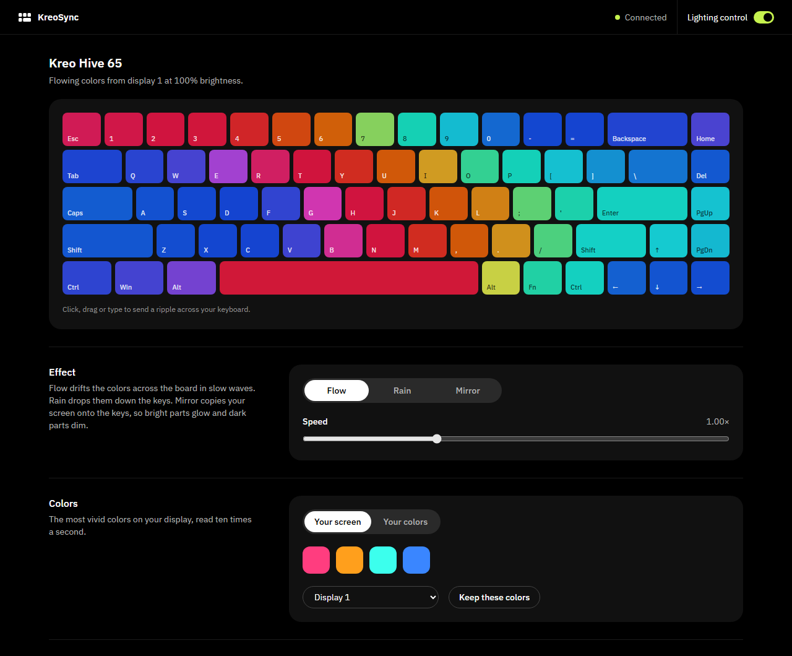
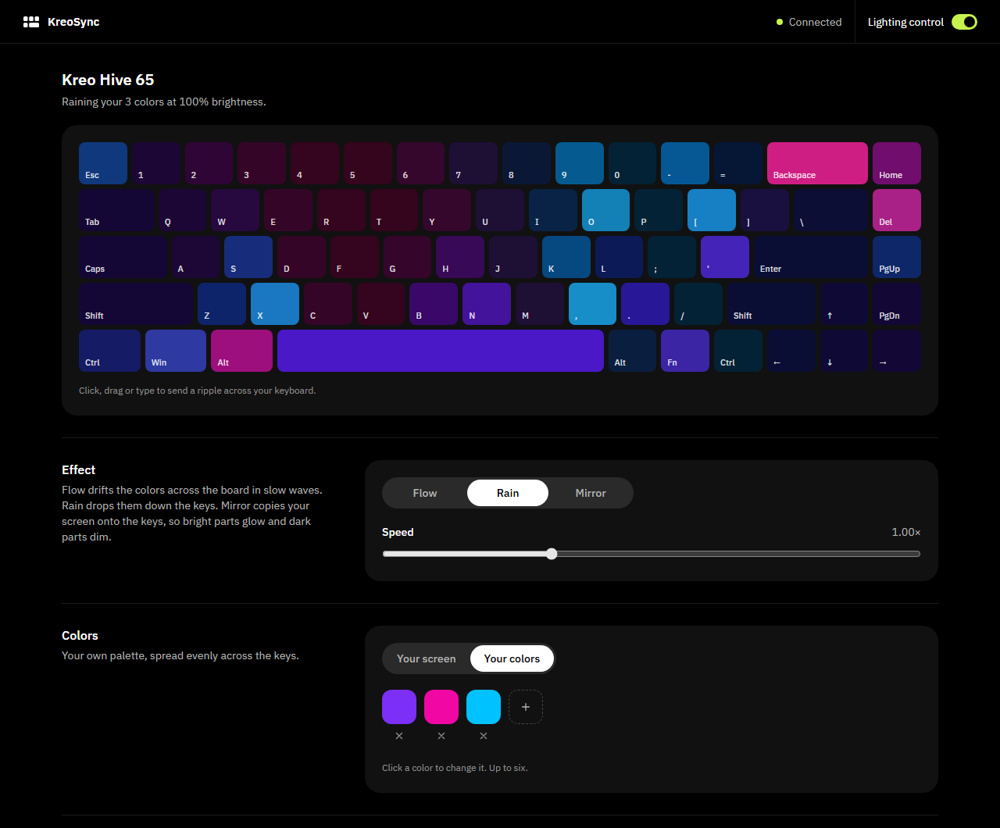
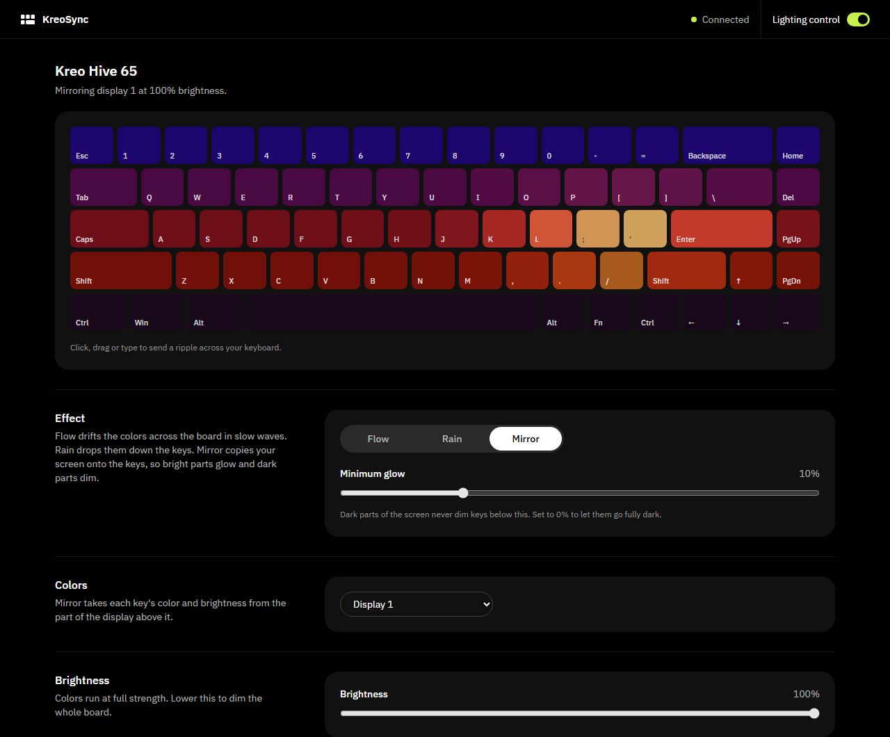

# KreoSync

Screen-reactive ambient lighting for the **Kreo Hive 65** keyboard on Windows. Inspired by
[LumiSync](https://github.com/Gxmi2006/LumiSync), but it talks to the keyboard directly over USB HID,
since OpenRGB doesn't support this board (USB `258a:010c`).

- **Flow**: the vivid colors on your screen drift across the keys in slow waves.
- **Rain**: drops in your screen's colors fall down the keys and splash on the bottom row.
- **Mirror**: each key takes the color and brightness of the part of the screen above it, with a
  minimum glow so dark scenes don't go fully black.
- A local control panel at `http://127.0.0.1:8765` with a live preview: click, drag or type on it
  to send ripples across the real keyboard, pick your own colors, and adjust speed and brightness.



<table>
  <tr>
    <td></td>
    <td></td>
  </tr>
  <tr>
    <td align="center">Rain with your own colors</td>
    <td align="center">Mirror copying a sunset onto the keys</td>
  </tr>
</table>

## Setup

```powershell
py -m venv .venv
.\.venv\Scripts\python -m pip install -r requirements.txt
.\.venv\Scripts\python kreosync.py
```

Use the keyboard wired and close the official Kreo software first. Then open
`http://127.0.0.1:8765`. Settings are saved to `settings.json`; problems are logged to `kreosync.log`.

To start it at login without a console window, put a shortcut to
`.venv\Scripts\pythonw.exe kreosync.py` in your Startup folder.

When KreoSync stops, the keyboard returns to its own lighting a few seconds later. It only ever
sends the verified per-LED frame (feature report 6); nothing is written to the keyboard's memory.

## Tests

```powershell
.\.venv\Scripts\python test_kreosync.py
```

## Credits

The keyboard's USB protocol and LED layout come from the reverse-engineering work in
[kreo-hive65-rgb-suite](https://github.com/Arman-Bisht/kreo-hive65-rgb-suite/blob/main/PROTOCOL.md).
This is an unofficial project, not affiliated with Kreo.

## License

[MIT](LICENSE)
